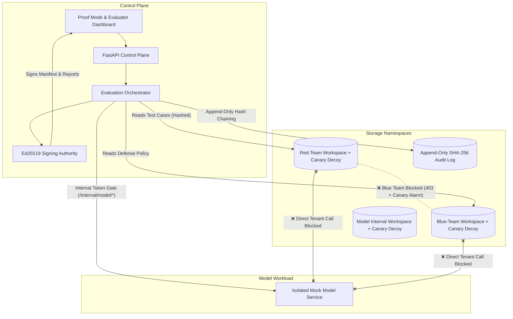

# Bayora — Secure Adversarial AI Safety Testing Infrastructure

> **Hackathon MVP v1.0** — Controlled single-host evaluation environment for AI models with strictly isolated red-team inputs, blue-team defenses, model state, and a tamper-evident audit trail.

---

## 1. Executive Summary & Core Mission

Adversarial model testing is difficult to trust when the attack team, defense team, and model share infrastructure. Shared files, credentials, networks, logs, or compute resources can expose sensitive test material or contaminate results. If that happens, the test is both insecure and scientifically invalid.

**Bayora** enforces explicit boundaries between roles and workloads, restricts communication to documented interfaces, and records all test events in a tamper-evident, append-only cryptographic audit chain.



---

## 2. Requirements & Verification Matrix

| ID | Requirement | Priority | Implementation & Empirical Evidence | Status |
| :--- | :--- | :---: | :--- | :---: |
| **Req 1** | **Isolation proof** | **Must** | Server-side role and resource enforcement between Red Team, Blue Team, and model service. Automated negative tests demonstrate that unauthorized cross-team API, storage, and direct network calls are denied (HTTP 403/400). | **PASSED** (SEC-01..04) |
| **Req 2** | **Canary secrets** | **Must** | Unique synthetic canary decoy tokens (`canary-red-payload-01`, `canary-blue-policy-01`, `canary-model-endpoint-01`) placed in isolated test workspaces. Unauthorized read probes trigger alarms, record trip events, and commit only SHA-256 fingerprints to audit logs—never leaking token values. | **PASSED** (SEC-08) |
| **Req 3** | **Proof Mode dashboard** | **Must** | Explicitly separates machine-verified mechanisms (8 tested controls) from documented assumptions and residual architectural limits (5 documented assumptions). Real-time matrix endpoint (`/api/security-tests/proof-mode`) and interactive UI. | **PASSED** (Live Matrix) |
| **Req 4** | **Tamper-evident audit trail** | **Must** | Append-only, SHA-256 hash-linked event log. Rigorously tested: modifying event payloads, deleting middle events, or swapping event order strictly breaks verification. Avoids claiming "immutable" without physical WORM storage. | **PASSED** (SEC-05, SEC-09) |
| **Req 5** | **Repeatable evaluations** | **Must** | Authorized operator can rerun identical configurations (`POST /api/eval/runs/{id}/rerun`) using deterministic `config_fingerprint` (SHA-256 of model ID, policy ID, sorted test IDs, and test-set version `2026.10-v1.0`). Side-by-side comparison modal calculates per-test deltas and reproducibility percentage. | **PASSED** (Rerun & Compare) |
| **Req 6** | **Evidence report** | **Must** | Exportable audit report (`GET /api/eval/runs/{id}/evidence-report` in Markdown and JSON). Contains run metadata, security checks, blocked attempt counts, hash-chain verification, and documented limitations. Redacts raw prompts via SHA-256 hashes and contains zero credentials. | **PASSED** (Markdown & JSON) |
| **Req 7** | **Risk disclosure** | **Must** | Transparent disclosures in UI and documentation: ordinary containers share host kernel and do not eliminate hardware/cache timing side-channels; audit log is tamper-evident but not WORM-immutable; bounded test suite cannot certify universal model safety. | **PASSED** (Threat Model) |

---

## 3. Proof Mode Matrix: Tested Mechanisms vs. Documented Assumptions

Bayora makes bounded security claims. The platform maintains an explicit distinction between what is **proven by automated tests** and what is an **architectural assumption**:

### Section A: Tested Mechanisms (Server-Side Enforced & Machine-Verified)
1. **CTRL-01 (Red Team Storage Isolation):** Prevents Blue Team participants from accessing unreleased Red Team attack payloads (Server-side 403 Forbidden).
2. **CTRL-02 (Blue Team Policy Isolation):** Prevents Red Team participants from inspecting Blue Team defense rules, classifiers, or guardrails (Server-side 403 Forbidden).
3. **CTRL-03 (Path Traversal Containment):** Strict path resolution rejects relative directory climbing outside designated workspace directories (HTTP 400 Bad Request).
4. **CTRL-04 (Model Interface Token Gate):** Prohibits direct tenant invocations to internal model endpoint without Orchestrator internal secret (HTTP 403 Forbidden).
5. **CTRL-05 (Audit Hash-Chain Tamper Detection):** SHA-256 cryptographic `prev_hash` linkage detects any payload modification.
6. **CTRL-06 (Ed25519 Manifest Cryptographic Signature):** Asymmetric Ed25519 signature guarantees run manifest authenticity and non-repudiation.
7. **CTRL-07 (Execution Timeout Limits):** Orchestrator async supervisor forcefully terminates workloads exceeding timeout limits.
8. **CTRL-08 (Canary Secret Probing Detection):** Synthetic decoy tokens placed in isolated workspaces trip alarms on unauthorized access without logging token secrets.
9. **CTRL-14 (Cryptographic Bearer Token Identity):** HMAC-SHA256 signed bearer tokens prevent identity spoofing and reject forged or tampered session roles.
10. **CTRL-15 (External Trust Anchor Checkpoint Ledger):** Anchors audit hash chain tip and Merkle root to external ledger with Ed25519 signature to prevent host rewrite attacks.
11. **CTRL-16 (Model Output Leakage & Egress Scanner):** Egress inspection intercepts and redacts confidential canaries, orchestrator tokens, or credentials in model completions.
12. **CTRL-17 (Concurrency Quota & Resource Governance):** Per-role concurrency limits prevent tenant noisy-neighbor resource exhaustion or evaluation starvation.

### Section B: Documented Hardening Specs & Residual Risks (What is Hardened vs Assumed)
1. **CTRL-09 (Shared Host Kernel Container Limitation):** Ordinary containers share the host operating system kernel; containerization does not eliminate CPU cache, timing, or microarchitectural side-channel risks. Production deployments should use hypervisor VM runtimes (e.g. Kata Containers, Firecracker).
2. **CTRL-10 (Out-of-Band Audit Anchoring):** While local append-only logs can be rewritten by a compromised root administrator, CTRL-15 external checkpoints provide verifiable cryptographic anchors that can be mirrored into cloud WORM / Object-Lock buckets.
3. **CTRL-11 (Bounded Safety Suite):** Passing safety evaluations does not certify that an AI model is safe or universally robust against unmodeled attacks. Coverage is bounded by test suite v2026.10-v1.0.
4. **CTRL-12 (Local Mock Inference Default):** Testing runs against a local deterministic model by default. No sensitive test prompts are sent to external third-party APIs.
5. **CTRL-13 (Privilege Separation, Non-Root & Micro-Segmentation):** Hardened `Dockerfile` enforces non-root UID 10001, dropped Linux capabilities (`CAP_DROP ALL`), read-only rootfs compatibility, and `docker-compose.yml` enforces 4 discrete internal networks (`red_team_net`, `blue_team_net`, `model_isolated_net`, `control_plane_net`) with no direct route between tenants and model.

---

## 4. Configuration & Security Hardening Settings

Bayora supports explicit runtime security configurations via environment variables:

| Variable | Default Value | Description |
| :--- | :--- | :--- |
| `BAYORA_STRICT_AUTH` | `false` | When `true`, enforces strict cryptographic `Authorization: Bearer <token>` authentication. All missing, empty, or unverified tokens return HTTP 401. Header-based simulation (`X-Bayora-Role`) is disabled. |
| `BAYORA_CORS_ORIGINS` | `http://127.0.0.1:8000,http://localhost:8000,http://127.0.0.1:3000,http://localhost:3000` | Comma-separated list of trusted web origins permitted for cross-origin requests. Credentialed access from arbitrary origins is strictly rejected. |
| `BAYORA_INTERNAL_SECRET` | Dynamic 256-bit entropy | High-entropy internal shared secret governing orchestrator-to-model control-plane invocations. |
| `BAYORA_AUTH_SECRET` | Dynamic 256-bit entropy | HMAC-SHA256 signing secret for session bearer tokens. |

### Deployment & Container Isolation Notes
- **Linux Containers & Kernel Separation:** The included `docker-compose.yml` configures 4 distinct, micro-segmented internal networks (`red_team_net`, `blue_team_net`, `model_isolated_net`, `control_plane_net`) with non-root UID 10001 and dropped Linux capabilities (`CAP_DROP ALL`).
- **Residual Risk (Kernel Shared Boundary):** Containerization provides OS-level namespace and cgroup boundaries, but containers share the host Linux kernel. As documented in Section B (CTRL-09), hardware microarchitectural and cache side-channels are not eliminated by Linux containers alone; hostile multi-tenant production deployments should run tenants in hypervisor microVMs (e.g., Firecracker, Kata Containers).

---

## 5. Reviewer Demo Walkthrough

Follow these steps to demonstrate every security boundary and capability to reviewers:

### Step 1: Start the Platform
```powershell
# From project root:
& "d:\Bayora\backend\.venv\Scripts\python.exe" run.py
```
Open your browser to: **`http://127.0.0.1:8000`**

### Step 2: Proof Mode Dashboard (Requirement 3)
1. Click the **Proof Mode & Matrix** tab in navigation (or click the green **Proof Mode: 8 Tested / 5 Assumed** pill in the top header).
2. Inspect **Section A (Server-Side Enforced & Tested Mechanisms)**: View all 8 passing mechanisms with empirical test evidence.
3. Inspect **Section B (Documented Assumptions & Residual Risks)**: View the 5 transparently disclosed architectural limits.
4. Click **Re-Verify Proof Matrix** to run live negative assertions across the backend.

### Step 3: Canary Secrets & Decoy Probing Detection (Requirement 2)
1. Click the **Boundaries & Canaries** tab.
2. Scroll to the **Canary Secrets & Decoy Probing Detection** panel:
   - Observe synthetic tokens: `canary-red-payload-01` in red_team workspace, `canary-blue-policy-01` in blue_team workspace, and `canary-model-endpoint-01` in model workspace.
   - Notice the status badge (`✓ INTACT`) and SHA-256 fingerprint (raw secret is concealed).
3. Click **Simulate Unauthorized Canary Probe**:
   - The system simulates an unauthorized read attempt by Blue Team targeting the Red Team canary.
   - An instant alert confirms: probe blocked (HTTP 403) and trip recorded in the hash-chain without exposing the fake secret.
   - The tripwire updates to `🚨 TRIPPED (1x)` and appears in the recent canary trips audit table.

### Step 4: Repeatable Evaluation Runs & Side-by-Side Comparison (Requirement 5)
1. Switch role to **Operator (Evaluator)** in the top header.
2. In the **Evaluation Console** tab, click **New Evaluation Run** and run an evaluation.
3. Once completed, click **Rerun Config**:
   - The orchestrator reruns the exact configuration with the identical `config_fingerprint` (SHA-256).
4. Click **Compare**:
   - The **Run Comparison & Reproducibility Delta** modal opens.
   - Confirms `Config Fingerprint Match: MATCH (Deterministic Identical Configuration)`.
   - Shows test-set version `2026.10-v1.0`, `Reproducibility Rate: 100.0%`, and per-test latency and outcome deltas.

### Step 5: Export Tamper-Evident Evidence Report (Requirement 6)
1. Click **Evidence Report** on the active run (or in the evaluation history table).
2. The modal previews the sanitized report:
   - Includes run ID, configuration fingerprint, test breakdown, audit chain status (`VALID`), Ed25519 signature status (`AUTHENTIC`), canary status (`INTACT` or alerts), Proof Mode score, and full residual risk disclosures.
   - Zero credentials or passwords leaked; sensitive attack prompts are represented by SHA-256 hashes.
3. Click **Download Markdown Report (.md)** or **Download JSON Metadata (.json)** to export compliance artifacts.

### Step 6: Tamper-Evident Audit Trail & Tamper Lab (Requirement 4)
1. Click the **Audit Trail & Tamper Lab** tab.
2. Click **Verify Entire Audit Chain**: confirms green cryptographic validity.
3. Under the **Adversarial Tamper Simulation Lab**:
   - Click **Tamper Event Payload**: alters an event payload in memory/storage. Click verify: verification strictly fails at that block index!
   - Click **Delete Middle Event**: removes an event. Click verify: verification fails with `prev_hash` broken link!
   - Click **Restore Clean Chain**: restores the verified chain.

---

## 5. Automated Test Suite

Run the full pytest suite from powershell:

```powershell
$env:PYTHONPATH = "d:\Bayora"
& "d:\Bayora\backend\.venv\Scripts\pytest.exe" -v d:\Bayora\backend\tests
```

**Results (26 passing tests, 0 failures):**
```
============================= test session starts =============================
platform win32 -- Python 3.13.7, pytest-9.1.1, pluggy-1.6.0
collected 26 items

backend/tests/test_api_endpoints.py::test_api_canaries_and_trips PASSED        [  3%]
backend/tests/test_api_endpoints.py::test_api_proof_mode_matrix PASSED         [  7%]
backend/tests/test_api_endpoints.py::test_api_repeatable_run_rerun_and_compare_and_report PASSED [ 11%]
backend/tests/test_audit_integrity.py::test_audit_hash_chain_creation PASSED   [ 15%]
backend/tests/test_audit_integrity.py::test_tamper_detection_modified_payload PASSED [ 19%]
backend/tests/test_audit_integrity.py::test_tamper_detection_deleted_event PASSED [ 23%]
backend/tests/test_audit_integrity.py::test_tamper_detection_reordered_events PASSED [ 26%]
backend/tests/test_auth_roles.py::test_missing_role_header_unauthorized PASSED  [ 30%]
backend/tests/test_auth_roles.py::test_invalid_role_forbidden PASSED           [ 34%]
backend/tests/test_auth_roles.py::test_reviewer_cannot_create_runs PASSED       [ 38%]
backend/tests/test_auth_roles.py::test_red_team_cannot_create_runs PASSED       [ 42%]
backend/tests/test_boundaries.py::test_blue_team_cannot_read_red_team_cases PASSED [ 46%]
backend/tests/test_boundaries.py::test_red_team_cannot_read_blue_team_policies PASSED [ 50%]
backend/tests/test_boundaries.py::test_path_traversal_is_blocked PASSED        [ 53%]
backend/tests/test_boundaries.py::test_tenant_cannot_call_internal_model_endpoint PASSED [ 57%]
backend/tests/test_boundaries.py::test_orchestrator_token_permits_internal_model_call PASSED [ 61%]
backend/tests/test_canary_secrets.py::test_canary_tokens_initialization PASSED  [ 65%]
backend/tests/test_canary_secrets.py::test_canary_probe_blocked_and_tripped PASSED [ 69%]
backend/tests/test_canary_secrets.py::test_canary_secrets_never_leak_in_audit_logs PASSED [ 73%]
backend/tests/test_canary_secrets.py::test_canary_tokens_hidden_from_standard_test_listings PASSED [ 76%]
backend/tests/test_evidence_report.py::test_evidence_report_generation_and_export PASSED [ 80%]
backend/tests/test_orchestrator.py::test_create_and_execute_evaluation_run PASSED [ 84%]
backend/tests/test_orchestrator.py::test_evaluation_run_timeout_limit_enforcement PASSED [ 88%]
backend/tests/test_repeatable_runs.py::test_repeatable_evaluation_and_comparison PASSED [ 92%]
backend/tests/test_repeatable_runs.py::test_config_fingerprint_changes_on_configuration_delta PASSED [ 96%]
backend/tests/test_signatures.py::test_ed25519_manifest_signing_and_verification PASSED [100%]

======================== 26 passed, 1 warning in 5.03s ========================
```

---

## 6. Security Principles Followed
- **Least Privilege:** Roles strictly limit write and read scopes on the server for every operation.
- **Canary Concealment:** Canary tokens use synthetic decoy content; audit records commit only to SHA-256 fingerprints, never logging raw secrets.
- **Privacy by Default:** Raw sensitive attack prompts are not included in exported manifests or evidence reports; only SHA-256 prompt hashes and sanitized summaries are stored.
- **Repeatability by Design:** Evaluators can verify reproducibility with deterministic config fingerprints and test-set versions.
- **No False Claims:** System is documented as *tamper-evident*, not unconditionally "immutable" without physical WORM media. Residual containerization risks are explicitly disclosed.
