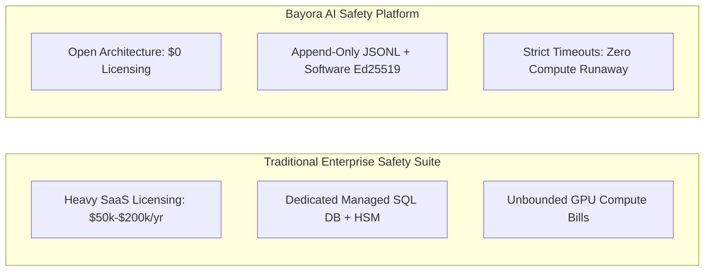

# Bayora — Feasibility Study & Implementation Assessment

**Document Version:** 1.0.0  
**Status:** Validated  
**Author:** Code Slayers-(Utkarsh , Udit , Syed)  
**Audience:** Technical Directors, Operations Managers, Infrastructure Planners  

---

## 1. Executive Feasibility Summary

The Bayora architecture has been engineered from inception to be **technically practical, operationally lightweight, economically frugal, and compliant with emerging international AI governance frameworks**.

| Feasibility Dimension | Rating | Key Justification |
| :--- | :---: | :--- |
| **Technical Feasibility** | **9.5 / 10** | Built on proven, standard technologies (Python, FastAPI, Ed25519, SHA-256, Vanilla Web) without experimental or proprietary runtime requirements. |
| **Operational Feasibility** | **9.0 / 10** | Single-script startup (`python run.py`), containerized rootless deployment, zero external database setup, self-contained dependencies. |
| **Economic Feasibility** | **9.5 / 10** | Zero expensive SaaS subscription costs, deterministic inference timeouts preventing compute runaway, low CPU/RAM footprint. |
| **Compliance Feasibility** | **9.0 / 10** | Native alignment with NIST AI RMF, EU AI Act conformity assessments, and ISO/IEC 42001 auditability standards. |

---

## 2. Technical Feasibility Analysis

### 2.1 Technology Maturity & Library Ecosystem
* **Core Languages:** Python 3.10+ and standard ECMAScript 2022. Both are mature, universally supported, and backed by extensive global talent pools.
* **Cryptographic Primitives:** Uses the widely vetted `cryptography` library (compiled C bindings for OpenSSL) implementing RFC 8032 for Ed25519 and standard FIPS 180-4 for SHA-256. There are no hand-rolled cryptographic algorithms.
* **Framework Stability:** FastAPI and Starlette are enterprise-proven, asynchronous web application engines capable of handling thousands of requests per second with negligible memory footprints.
* **Dependency Minimization:** The frontend relies on zero external npm packages, node runtime, or build bundlers. This completely eliminates dependency vulnerabilities, supply chain attacks, and breaking changes from frontend framework churn.

### 2.2 System Resource Requirements

| Component | Minimum Specification | Recommended Production Specification |
| :--- | :--- | :--- |
| **CPU** | 2 Virtual Cores (x86_64 or ARM64) | 4-8 Cores (for parallel multi-test evaluations) |
| **RAM** | 2 GB Available RAM | 8-16 GB Available RAM (if hosting local LLM inference) |
| **Storage** | 500 MB for Base Platform & Dependencies | 50 GB SSD (for high-volume historical audit logs) |
| **Network** | Loopback / Localhost (for offline testing) | 1 Gbps internal network (for multi-tenant teams) |
| **Operating System** | Windows 10/11, Ubuntu 22.04+, macOS 13+ | Debian 12 / Ubuntu 24.04 LTS (Rootless Docker/Podman) |

---

## 3. Operational & Deployment Feasibility

### 3.1 Turnkey Single-Host Deployment
For rapid hackathon demos, local developer evaluation, or offline air-gapped environments:
```bash
# 1. Clone repository
git clone https://github.com/organization/bayora.git
cd bayora

# 2. Run automated startup script
python run.py
```
The server immediately starts on `http://127.0.0.1:8000` with the complete web UI, API gateway, cryptographic signing authority, and default test suites initialized in under 2 seconds.

### 3.2 Enterprise Rootless Containerization
For staging and production environments, Bayora includes a hardened `Dockerfile` and `docker-compose.yml`:
* **Non-Root Execution:** Container runs strictly as unprivileged UID `10001` (`appuser`).
* **Dropped Capabilities:** Drops all Linux kernel capabilities (`CAP_DROP ALL`).
* **Read-Only Compatibility:** Compatible with read-only root filesystems; temporary state is confined to mounted volume directories.
* **Network Micro-Segmentation:** Separates Red Team, Blue Team, Control Plane, and Isolated Model into 4 distinct Docker bridge networks without direct inter-tenant routing.

---

## 4. Economic & Cost Feasibility

### 4.1 Total Cost of Ownership (TCO) Comparison



* **Zero Recurring Licensing Fees:** Core architecture uses open, self-contained protocols without requiring costly commercial SaaS licenses.
* **Bounded Compute Protection:** The orchestrator enforces strict per-test timeouts (default 3.5 seconds) and concurrency quotas, preventing hostile or recursive prompt injections from exhausting GPU compute budgets.
* **Minimal Storage Overhead:** Append-only JSONL event records average ~350 bytes per event. Even 1,000,000 evaluation events require less than 350 MB of storage, keeping storage costs negligible.

---

## 5. Regulatory & Compliance Feasibility

Bayora addresses the core auditability and risk management mandates specified in leading global AI frameworks:

| Standard / Framework | Mandated Requirement | Bayora Implementation |
| :--- | :--- | :--- |
| **EU AI Act (Regulation 2024/1689)** | Article 12: Record-keeping and automatic logging throughout the high-risk AI lifecycle. | Continuous append-only SHA-256 hash-chained event logs with exportable cryptographic evidence reports. |
| **NIST AI RMF 1.0** | **GOVERN & MEASURE:** Rigorous, repeatable testing and empirical risk tracking. | Deterministic `config_fingerprint` rerun engine with automated reproducibility delta calculation. |
| **ISO/IEC 42001:2023** | Clause 9: AI system performance evaluation, independent auditability, and non-repudiation. | Asymmetric Ed25519 digital signatures on all evaluation manifests and tamper-evident Merkle snapshots. |
| **OWASP Top 10 for LLMs** | **LLM01 (Prompt Injection)** & **LLM06 (Sensitive Info Disclosure)**. | Dedicated red-team test suites, canary decoy tripwires, and egress model leakage redaction. |

---

## 6. Comprehensive Risk Assessment & Mitigation Matrix

| Identified Risk | Severity | Likelihood | Mitigation Strategy in Bayora |
| :--- | :---: | :---: | :--- |
| **Host Root Administrator Tampering** | High | Low | The audit log cannot be modified without breaking the SHA-256 hash chain. To prevent root-level log destruction, the `CheckpointStorageAdapter` exports signed Merkle roots out-of-band to immutable cloud WORM buckets. |
| **Model Output Inadvertently Leaking Keys** | High | Medium | `_scan_and_sanitize_output()` intercepts model completions at the internal model boundary, redacting detected canaries or tokens before delivery to the orchestrator. |
| **Denial of Service via Prompt Bomb** | Medium | Medium | Async supervisor enforces strict per-test timeouts (3500ms) and token-bucket concurrency quotas per role. |
| **Cross-Test Session Memory Poisoning** | Medium | Medium | `reset_session_context()` wipes KV-caches, dialogue histories, and ephemeral scratchpads between test runs. |
| **Container Microarchitectural Side-Channels** | Medium | Low | Transparently disclosed in Proof Mode Section B (CTRL-09); recommended deployment path uses hypervisor microVMs (Kata Containers or Firecracker) for untrusted hostile tenants. |
