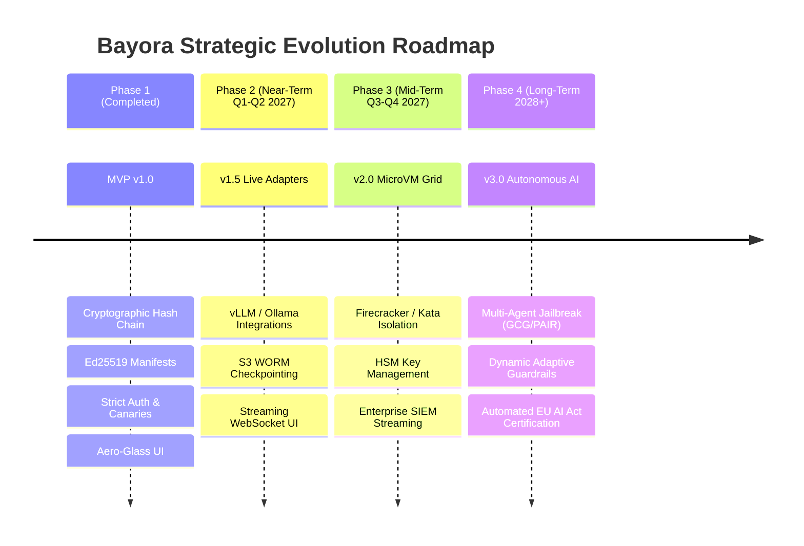
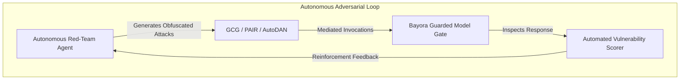

# Bayora — Future Scope & Strategic Technical Roadmap

**Document Version:** 1.0.0  
**Status:** Approved Architectural Vision  
**Author:** Code Slayers-(Utkarsh , Udit , Syed)  
**Target Horizon:** 2026 – 2028  
**Audience:** Product Strategy, AI Safety Researchers, Enterprise Engineering  

---

## 1. Evolution Vision: From MVP to Enterprise AI Safety Grid

Bayora MVP v1.0 successfully establishes the foundational cryptographic and architectural guarantees of adversarial AI testing: **tenant boundary isolation, tamper-evident hash chaining, canary tripwires, Ed25519 signed manifests, and honest proof disclosures.**

The future roadmap scales these core principles from a single-host, controlled evaluation testbed to a **distributed, hypervisor-isolated, multi-region enterprise AI safety and compliance grid**.

---

## 2. Phase-by-Phase Technical Roadmap

### Phase 2: Live Model Ecosystem & Cloud WORM Checkpointing (v1.5)
*Target: Q1 – Q2 2027*

#### 2.1 Pluggable Live Model Adapters
Transition from the deterministic safety mock model to production inference engines via standardized adapters:
* **Local Fast Inference:** Native connectors for **vLLM**, **Ollama**, and **HuggingFace TGI** with dynamic batching.
* **Commercial Model Proxy:** Secure outbound proxy with rate limiting for **OpenAI**, **Anthropic Claude**, and **Google Gemini** endpoints.
* **Zero-Retention Guarantees:** Strict enforcement of zero-data-retention headers (`no-store`, `ephemeral-session`) to ensure external API providers do not store proprietary evaluation prompts.

#### 2.2 Cloud WORM Storage Adapter Implementation
Implement concrete cloud adapters inheriting from Bayora's `CheckpointStorageAdapter`:
* **AWS S3 Object Lock Adapter:** Periodically snapshots Merkle roots directly to S3 buckets configured with strict Legal Hold / Compliance Mode WORM policies.
* **Azure Blob Immutable Storage:** Automated write-once-read-many ledger mirroring.
* **Decentralized Timestamping:** Optional anchoring of Merkle roots to public timestamping authorities (e.g., RFC 3161 or public ledger chains) for third-party non-repudiation.

#### 2.3 Streaming Real-Time Evaluation & WebSockets
* Replace polling with bidirectional WebSocket streams (`/ws/eval/live-stream`).
* Live terminal-style streaming of test progress, token generation rates, and real-time guardrail interception events directly in the web UI.

---

### Phase 3: Hardware Hypervisor MicroVMs & Enterprise HSM (v2.0)
*Target: Q3 – Q4 2027*

#### 3.1 Hardware-Assisted MicroVM Workload Isolation
Eliminate the residual risk of shared host Linux kernel containers (disclosed in Proof Mode CTRL-09) by introducing lightweight hardware virtualization:
* **AWS Firecracker / Kata Containers Integration:** Each red-team evaluation script and blue-team guardrail plugin executes inside an ephemeral microVM booted in <50 milliseconds.
* **Complete Memory & CPU Isolation:** Dedicated virtual CPUs, independent guest kernels, and separate memory spaces prevent hardware timing, cache-probing, or speculative execution side-channels (Spectre/Meltdown variants).

#### 3.2 Hardware Security Module (HSM) Key Management
* Move Ed25519 signing private keys from software memory into **FIPS 140-2 Level 3 Hardware Security Modules** (AWS CloudHSM, Azure Key Vault Managed HSM, or YubiHSM2).
* Guarantees that private keys can never be extracted or read, even by system administrators possessing physical server access.

#### 3.3 Enterprise SIEM & Real-Time Event Streaming
* **High-Throughput Log Streaming:** Native connectors forward audit hash events to **Apache Kafka**, **Splunk HEC**, **Datadog**, and **AWS CloudWatch**.
* **Instant Incident Response:** Automated alerts dispatched to PagerDuty or Slack when canary decoy secrets are probed.

---

### Phase 4: Autonomous Multi-Turn Adversarial Agents (v3.0)
*Target: 2028+*

#### 4.1 Algorithmic & Generative Jailbreak Synthesis
Incorporate state-of-the-art automated adversarial attack algorithms:
* **Greedy Coordinate Gradient (GCG):** Automated token-level suffix optimization to find adversarial bypass triggers.
* **Prompt Automatic Iterative Refinement (PAIR):** Multi-turn LLM-versus-LLM automated jailbreak generation where an attacker model iteratively refines prompts based on guardrail responses.
* **AutoDAN & Multi-Modal Exploits:** Support for multi-modal adversarial vectors (adversarial images, audio steganography, and multilingual cross-lingual jailbreaks).

#### 4.2 Dynamic Adaptive Guardrail Evolution
* Enable Blue Teams to test self-healing guardrails. When an adversarial exploit succeeds, the system automatically suggests optimized regex tripwires, semantic embedding thresholds, or system prompt patches to neutralize the vulnerability.

#### 4.3 Automated Regulatory Compliance Dossier Generator
* **One-Click Regulatory Dossiers:** Produce ready-to-file regulatory packs tailored specifically for:
  - **EU AI Act:** Technical documentation for Annex IV conformity assessments.
  - **NIST AI RMF:** Comprehensive Profiles and Evidence Logs for High-Risk AI deployments.
  - **US Executive Order 14110:** Red-team safety reporting artifacts for dual-use foundation models.
* Export formats include cryptographically signed PDF compliance packs, machine-readable JSON-LD, and verifiable cryptographic certificates.

---

## 3. Summary of Milestones & Success Metrics

| Milestone | Target Horizon | Core Technical Deliverable | Primary Success Metric |
| :--- | :---: | :--- | :--- |
| **v1.0 (Current)** | **Present** | Isolated MVP, SHA-256 Hash Chain, Ed25519 Signatures, Proof Mode UI. | 100% test pass rate (43/43 tests), zero cross-workspace leaks. |
| **v1.5** | **Q2 2027** | vLLM / Ollama adapters, AWS S3 Object Lock, WebSocket live stream. | Real model inference integration with sub-second audit recording. |
| **v2.0** | **Q4 2027** | Firecracker microVMs, CloudHSM key storage, Kafka/Splunk streaming. | Complete kernel hardware isolation for untrusted test code. |
| **v3.0** | **2028** | Autonomous PAIR/GCG jailbreak engines, automated EU AI Act dossiers. | Continuous, hands-free adversarial benchmarking and certification. |
