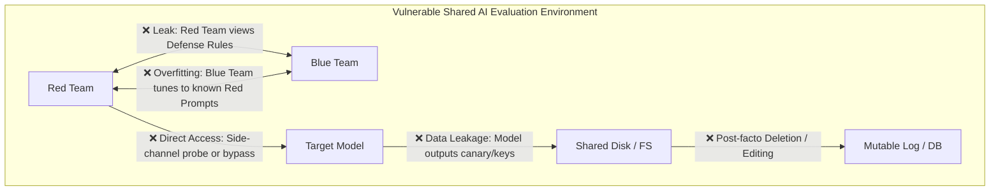
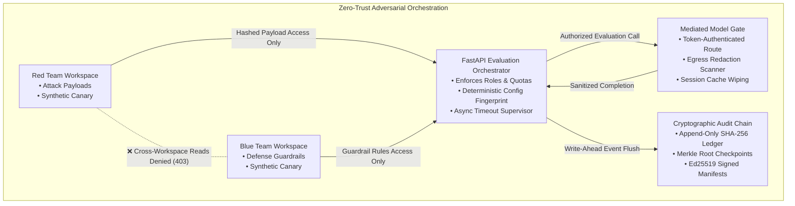

# Bayora — Problem Statement & Solution Architecture

**Document Version:** 1.0.0  
**Status:** Comprehensive Analysis  
**Author:** Code Slayers-(Utkarsh , Udit , Syed)  
**Audience:** Chief Information Security Officers (CISOs), AI Safety Researchers, Compliance Officers  

---

## 1. The Problem Statement: The Adversarial AI Safety Paradox

As artificial intelligence models are deployed into mission-critical, enterprise, and regulated environments, organizations subject them to rigorous adversarial testing—commonly known as **Red Teaming**. During these exercises, adversarial researchers ("Red Team") attempt to induce safety failures, prompt injections, jailbreaks, data exfiltration, and toxic generation, while defense engineers ("Blue Team") develop guardrails, classifiers, and system prompts to block these attempts.

However, existing adversarial evaluation practices suffer from a fundamental, critical paradox:

> **The Evaluation Trust Paradox:**  
> Adversarial evaluation cannot produce scientifically valid or trustworthy security conclusions when the attacking team, the defending team, and the target model share the same execution, storage, network, and logging infrastructure.

---

## 2. Real-World Failure Modes in Shared Environments

In current industry practice, red-teaming exercises frequently operate on shared clusters, shared virtual machines, or common web platforms. This leads to five severe failure modes:

### 2.1 Mutual Information Contamination & Guardrail Overfitting
* **The Vulnerability:** When Blue Team engineers can inspect upcoming Red Team attack vectors or test datasets before the evaluation, they inevitably overfit defenses to those specific test cases (e.g., creating hardcoded keyword blocklists matching the attack prompts).
* **The Consequence:** The model appears to pass safety benchmarks with flying colors, but fails immediately when exposed to real-world adversaries using unreleased variants.

### 2.2 Covert Reconnaissance & Defense Invalidation
* **The Vulnerability:** Conversely, if Red Team members can view Blue Team defense rules, system prompts, or regex classifiers, they can easily craft obfuscated adversarial payloads designed specifically to bypass the visible rules (e.g., using Base64 encoding, ROT13, or character insertion).
* **The Consequence:** The red team bypasses defenses unrealistically fast, creating unrepresentative test conditions that do not reflect true zero-knowledge defense resilience.

### 2.3 Mutable Logs & Post-Evaluation Evidence Tampering
* **The Vulnerability:** Standard evaluation frameworks store test results in standard relational databases (PostgreSQL, SQLite) or plain text logs. Anyone with administrator or database write access can alter outcome records, delete failed test cases, or reorder events after an embarrassing security failure.
* **The Consequence:** Compliance audits, safety certifications, and executive reports lose all non-repudiation. There is no proof that the submitted report reflects the actual test run.

### 2.4 Egress Leakage & Cross-Test State Poisoning
* **The Vulnerability:** Target LLMs maintain in-memory KV-caches, session contexts, or scratchpad memories. If a model is subjected to jailbreak attempts that query system keys, and then subsequently evaluated on an innocuous prompt, internal states or synthetic canary secrets can leak across tests.
* **The Consequence:** Sensitive secrets injected in earlier tests become compromised in subsequent test outputs.

### 2.5 The "Illusion of Universal Safety"
* **The Vulnerability:** Vendors frequently issue broad, misleading claims stating that their model is "certified 100% safe" after passing a 50-prompt test suite.
* **The Consequence:** Stakeholders mistake passing a bounded evaluation suite for universal safety against novel, unknown attack vectors.

---

## 3. The Bayora Solution Architecture

**Bayora** resolves the Evaluation Trust Paradox by introducing a zero-trust, cryptographically mediated orchestration architecture.

### 3.1 Cryptographic Multi-Tenant Namespacing
* Workspaces are segregated into discrete storage namespaces (`/backend/data/red_team/` vs. `/backend/data/blue_team/`).
* Server-side route handlers enforce cryptographic role checks. Blue Team members receive HTTP 403 Forbidden when requesting Red Team data, and vice versa.
* File system paths are strictly normalized to prevent relative traversal (`../`) attacks.

### 3.2 Mediated Internal Token Gate & Egress Redaction
* Direct network or API calls from tenant workstations to the model endpoint are blocked at the firewall/route level.
* The model accepts execution commands *exclusively* from the Orchestrator via an internal endpoint (`/internal/model/evaluate`) protected by a high-entropy internal secret.
* An egress inspection engine scans all model outputs before they leave the model boundary. Any inadvertent exposure of canary tokens or credentials is automatically redacted.
* After every evaluation run, the orchestrator invokes `reset_session_context()` to wipe KV caches and ephemeral scratchpads.

### 3.3 Append-Only Cryptographic Hash Chain & Merkle Checkpoints
* Every single lifecycle event—from test dispatch to canary tripwire alarms—is appended to an append-only JSONL log.
* Each entry computes a SHA-256 hash incorporating the previous entry's hash:
  $$\text{entry\_hash}_i = \text{SHA-256}(\text{entry\_hash}_{i-1} \parallel \text{payload\_hash}_i \parallel \text{meta}_i)$$
* An operator can instantly run `/api/audit/verify` to validate the unbroken continuity of the ledger. If even a single byte or character in any historical record has been modified, deleted, or reordered, the verification fails instantly with the exact block index of the breach.
* Merkle root snapshots are anchored to external storage adapters (`CheckpointStorageAdapter`) signed with an Ed25519 asymmetric private key.

### 3.4 Decoy Canary Secrets & Active Tripwires
* Bayora injects synthetic decoy secrets into isolated workspaces (`canary-red-payload-01`, `canary-blue-policy-01`, `canary-model-endpoint-01`).
* Any unauthorized access attempt or directory scan targeting a canary trips an immediate alarm, logs the attempt to the cryptographic audit chain, and denies the request.
* Raw canary values are never logged or returned; only their SHA-256 fingerprints are recorded, preventing the tripwire mechanism itself from leaking secrets.

### 3.5 Deterministic Repeatability & Delta Engine
* Every evaluation calculates a deterministic `config_fingerprint` (SHA-256 of model ID, policy ID, sorted test case IDs, and test-suite version `2026.10-v1.0`).
* Operators can re-run historical configurations with a single click.
* The system computes side-by-side comparison deltas, tracking outcome stability (SAFE vs. EXPLOITED vs. TIMEOUT), execution latency drift, and reproducibility score.

### 3.6 Honest Proof Mode: Tested Mechanisms vs. Documented Assumptions
Bayora rejects the practice of making inflated, unprovable claims. In both the UI and exported evidence reports, security claims are split into two distinct, clear categories:
1. **Section A (Tested Mechanisms):** Controls verified by automated negative test suites (tenant isolation, canary alerts, hash-chain tamper detection, Ed25519 signatures, timeouts).
2. **Section B (Documented Assumptions & Residual Risks):** Transparent disclosure of physical boundaries (e.g., acknowledging that standard containers share the host Linux kernel, and that physical hardware immutability requires external WORM storage).

---

## 4. Comparative Architecture Matrix

| Feature / Guarantee | Standard Shared AI Testbed | Naive Prompt Evaluation Tools | **Bayora Safety Platform** |
| :--- | :---: | :---: | :---: |
| **Red / Blue Team Isolation** | ❌ None (Shared DB/FS) | ❌ None (Single User) | **✅ Cryptographic & Role Enforced** |
| **Audit Log Integrity** | ❌ Mutable SQL/Text Log | ❌ Transient / Unsigned | **✅ Append-Only SHA-256 Hash Chain** |
| **Evidence Non-Repudiation** | ❌ None | ❌ None | **✅ Asymmetric Ed25519 Signatures** |
| **Tripwire Intrusion Detection** | ❌ None | ❌ None | **✅ Active Canary Decoy Secrets** |
| **Model Egress Data Redaction** | ❌ Uninspected Stream | ❌ Raw Output Only | **✅ Egress Canary & Key Filter** |
| **Evaluation Determinism** | ⚠️ Variable / Flaky | ⚠️ Best-effort | **✅ Exact SHA-256 Config Fingerprint** |
| **Side-Channel Disclosures** | ❌ Hidden / Ignored | ❌ Ignored | **✅ Explicit Proof Mode Matrix** |
