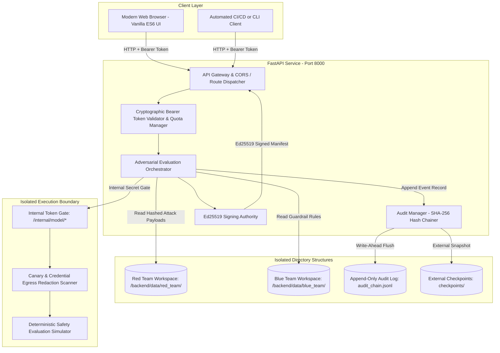

# Bayora — Technology Stack & Architecture Specification

**Document Version:** 1.0.0  
**Status:** Implemented & Verified  
**Author:** Code Slayers-(Utkarsh , Udit , Syed)  
**Target Audience:** Infrastructure Engineers, Security Architects, Full-Stack Developers  

---

## 1. Architecture Overview

Bayora uses a clean, decoupled architecture separating the **Control Plane**, **Storage Namespaces**, **Cryptographic Authority**, and **Model Workload**.



---

## 2. Component Breakdown

### 2.1 Backend Core
* **Framework:** **FastAPI** (`0.109.0+`) running on top of **Starlette** and **Uvicorn** (`0.27.0+`).
* **Runtime:** **Python 3.10+** (tested up to Python 3.12).
* **Data Serialization & Validation:** **Pydantic v2** (`pydantic>=2.6.0`). Strict typing on all API request/response contracts, rejecting unexpected fields.
* **Asynchronous Concurrency:** Python native `asyncio` for non-blocking I/O during multi-test evaluations, canary probes, and audit chain verification.

### 2.2 Cryptographic Infrastructure
* **Digital Signatures:** **Ed25519** via Python `cryptography` library (`cryptography>=42.0.0`).
  - Private key generates at initialization (or loads from secure environment variables).
  - Manifests, evidence reports, and external audit checkpoints are signed and verifiable via public key endpoint (`/api/crypto/public-key`).
* **Hash Chaining:** **SHA-256** (`hashlib.sha256`) implemented in `backend/app/audit.py`.
  - Every log entry computes:
    $$\text{entry\_hash} = \text{SHA-256}(\text{prev\_hash} + \text{payload\_hash} + \text{timestamp} + \text{event\_type} + \text{actor})$$
* **Stateless Session Authentication:** **HMAC-SHA256** signed bearer tokens (`backend/app/auth.py`). Tokens encode `role`, `user_id`, and `exp` without requiring an external database.
* **Checkpoint Anchoring:** `CheckpointStorageAdapter` interface supports exporting Merkle root snapshots to external files or cloud WORM storage.

### 2.3 Frontend Engine & Design System
* **Architecture:** Zero-framework, native **Vanilla ES6+ JavaScript** and **Vanilla CSS3**.
* **Zero Build Pipeline:** No Webpack, Vite, or Babel overhead. Direct browser execution ensures sub-millisecond initial parsing and instant hot-reloads during maintenance.
* **Aero-Glass Visual Engine (`style.css`):**
  - **Dynamic Background:** High-resolution hardware-accelerated looping ambient cosmic nebula video (`opacity: 0.95; z-index: -10; pointer-events: none;`).
  - **Translucent Frosted Glass:** `rgba(13, 20, 38, 0.45)` card backgrounds backed by `backdrop-filter: blur(20px) saturate(190%)`.
  - **Color Palette & Contrast:**
    - Background Gradient: Deep Abyss Navy (`#030712` to `#0b132b`).
    - Primary Accents: Cyber Sky Cyan (`#0ea5e9`), Electric Indigo (`#6366f1`), Luminous Purple (`#a855f7`).
    - Status Indicators: Neon Emerald (`#10b981`), Radiant Crimson (`#f43f5e`), Electric Amber (`#f59e0b`).
    - Typography: Pure White (`#ffffff`) headers with subtle glow shadows, ensuring crisp WCAG AAA contrast against the dynamic backdrop.

---

## 3. Directory & Module Organization

```
d:\Bayora\
├── backend\
│   ├── app\
│   │   ├── __init__.py
│   │   ├── config.py             # Security parameters, secrets, CORS origins
│   │   ├── auth.py               # HMAC bearer tokens, role checks, quota manager
│   │   ├── audit.py              # SHA-256 hash-chain, Merkle checkpoints
│   │   ├── crypto.py             # Ed25519 keypair generation and manifest signing
│   │   ├── orchestrator.py       # Evaluation lifecycle, timeout supervisor, rerun engine
│   │   ├── mock_model.py         # Isolated inference mock, canary egress redaction
│   │   ├── routes\
│   │   │   ├── __init__.py
│   │   │   ├── auth_routes.py    # /api/auth/token, /api/auth/session
│   │   │   ├── eval_routes.py    # /api/eval/runs, rerun, compare, evidence-report
│   │   │   ├── audit_routes.py   # /api/audit/chain, /api/audit/verify, checkpoints
│   │   │   ├── security_routes.py# /api/security-tests/proof-mode, canary alerts
│   │   │   ├── workspace_routes.py# /api/workspaces/red-team, blue-team
│   │   │   └── internal_routes.py# /internal/model/evaluate (orchestrator-only)
│   │   └── main.py               # FastAPI application factory, CORS, static mounts
│   ├── data\
│   │   ├── audit\audit_chain.jsonl # Append-only cryptographic ledger
│   │   ├── red_team\             # Isolated Red Team test cases & canary
│   │   ├── blue_team\            # Isolated Blue Team defense policies & canary
│   │   └── model\                # Isolated model state & canary
│   └── tests\                    # 43 automated Pytest assertions
├── frontend\
│   ├── index.html                # Single-page interface with embedded video background
│   ├── css\style.css             # Aero-glass design tokens & responsive components
│   └── js\app.js                 # API client, role manager, reactive UI dispatcher
├── documentation\                # Project documentation package
├── run.py                        # Unified single-command launcher
├── Dockerfile                    # Hardened rootless OCI container definition
└── docker-compose.yml            # Multi-network micro-segmented orchestration
```

---

## 4. Security & Boundary Enforcement Architecture

### 4.1 Multi-Layer Defense-in-Depth

| Layer | Enforced Boundary | Implementation Mechanism |
| :--- | :--- | :--- |
| **Network & Transport** | Micro-segmented Docker Networks | 4 discrete internal bridge networks: `red_team_net`, `blue_team_net`, `model_isolated_net`, `control_plane_net`. Zero direct IP routing between tenants and model. |
| **API & Authentication** | Cryptographic Bearer Tokens | `BAYORA_STRICT_AUTH=true` rejects unauthenticated callers with HTTP 401; HMAC-SHA256 tokens validate actor role on every protected route. |
| **Cross-Origin Requests** | Strict CORS Origin Allowlists | Only configured origins (`BAYORA_CORS_ORIGINS`) receive CORS headers. Wildcards (`*`) are disallowed for credentialed routes. |
| **File System Access** | Path Normalization & Jails | `Path(target).resolve().is_relative_to(allowed_dir)` strictly prevents directory traversal attacks (`../`). |
| **Internal Model Access** | Orchestrator Secret Token Gate | `/internal/model/evaluate` requires `X-Internal-Token` matching `ORCHESTRATOR_INTERNAL_SECRET`. Direct calls return 403 Forbidden. |
| **Output Data Leakage** | Egress Data Redaction Scanner | Model responses are scanned via regex and fingerprint comparisons before returning. Detected canaries or keys are replaced with `[REDACTED_LEAK_PREVENTION]`. |
| **Audit Log Integrity** | SHA-256 Hash-Chaining & Merkle Roots | Every event links to `prev_hash`. Modification of any prior line invalidates the chain tip. |

---

## 5. Storage Formats & Data Schemas

### 5.1 Append-Only Audit Chain (`audit_chain.jsonl`)
Every event is stored as an immutable single-line JSON record:
```json
{
  "index": 1187,
  "event_id": "evt_7f10b2c8901e",
  "timestamp": "2026-10-19T20:28:10.124Z",
  "event_type": "EVAL_COMPLETED",
  "role": "operator",
  "actor": "evaluator-01",
  "action": "execute_eval_suite",
  "payload_hash": "e3b0c44298fc1c149afbf4c8996fb92427ae41e4649b934ca495991b7852b855",
  "prev_hash": "a1b2c3d4e5f6...",
  "entry_hash": "9f8e7d6c5b4a..."
}
```

### 5.2 Ed25519 Signed Evaluation Manifest (`run_manifest.json`)
```json
{
  "run_id": "run_20261019_202810_4",
  "timestamp": "2026-10-19T20:28:10.124Z",
  "config_fingerprint": "7d8ceddadeeb8298a0021f1589be76229415b3c3b52d9a4f483750882e3a1f11",
  "model_id": "mock-safety-llama-8b-v1",
  "policy_id": "policy-lenient",
  "test_count": 5,
  "safe_count": 2,
  "exploited_count": 3,
  "timeout_count": 0,
  "audit_tip_hash": "9f8e7d6c5b4a...",
  "signature": "30450221008fbc... (Ed25519 hex signature)"
}
```

---

## 6. Testing, CI & Verification

The Bayora codebase is accompanied by an automated test suite executed via `pytest`:
* **Total Automated Tests:** 43 tests across 8 test suites.
* **Coverage Scope:**
  - `test_auth_roles.py`: Negative testing for role spoofing, privilege elevation, and missing tokens.
  - `test_boundary_enforcement.py`: Negative assertions for cross-tenant workspace reads/writes.
  - `test_audit_integrity.py`: Synthetic tamper attacks (modifying payloads, deleting events, reordering events).
  - `test_canaries.py`: Canary tripwire alert triggering and token secret concealment.
  - `test_cors_and_strict_auth.py`: Strict CORS headers, untrusted origin rejection, and bearer token verification.
  - `test_eval_orchestrator.py`: Deterministic rerun verification, configuration fingerprint matching, and timeout execution termination.
